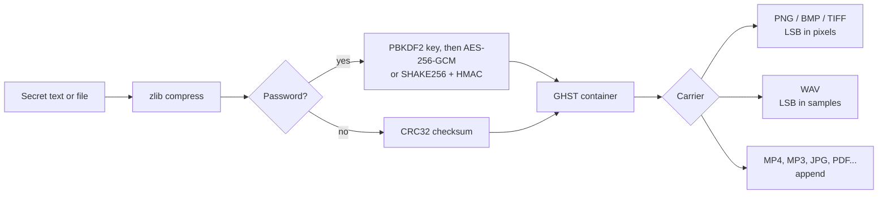

<div align="center">

```
   ████ █   █  ███   ████ █████ ████  █   █ █████ █████
  █     █   █ █   █ █       █   █   █  █ █    █   █
  █ ███ █████ █   █  ███    █   ████    █     █   ████
  █   █ █   █ █   █     █   █   █   █   █     █   █
   ████ █   █  ███  ████    █   ████    █     █   █████
```

### ◢◤ hide anything in anything ◥◣

**An advanced steganography toolkit with a colourful CLI and an animated GUI.**
Hide text or files inside images, audio, video and almost any other file, with optional encryption.


[Features](#-features) · [Install](#-install) · [CLI](#-cli-usage) · [GUI](#-gui) · [How it works](#-how-it-works) · [Limits](#-limits-and-honest-notes)

</div>

<!--
  Add screenshots here once you have them, for example:
  
  
-->

---

## ✨ Features

| | |
|---|---|
| 🖼️ **Image LSB** | PNG / BMP / TIFF carriers, 1, 2 or 4 bits per channel, alpha channel preserved. Other image types (JPG, WebP, GIF) can be read and are saved out as PNG. |
| 🔊 **Audio LSB** | PCM WAV files, hidden in the lowest byte of each sample. |
| 🎬 **Any file** | MP4, MOV, MP3, JPG, PDF, ZIP and more via *append mode*. MP4/MOV payloads go inside a valid `free` box so players keep working. |
| 🔐 **Encryption** | PBKDF2-SHA256 (200k rounds) with AES-256-GCM. Without the `cryptography` package it falls back to a stdlib SHAKE-256 stream cipher with HMAC-SHA256 (encrypt-then-MAC). |
| 📦 **Compression** | zlib, applied automatically when it makes the payload smaller. |
| 🔎 **Scanner** | Detects appended payloads, trailing bytes after PNG/JPEG, oversized MP4 `free` boxes, GhostByte LSB signatures, and runs a chi-square LSB test. |
| 🧹 **Cleaner** | Strips an appended payload and restores the original carrier byte for byte. |
| 🧪 **Self-test** | One command round-trips every carrier type, checks wrong-password handling and the capacity guard. |
| 🎨 **Themes & effects** | 7 colour themes, gradient banner, matrix-rain intro, gradient progress bars and a typewriter reveal in the CLI. Animated banner, rain or starfield header, colour pickers and font choices in the GUI. |
| 📁 **One file** | Everything lives in `ghostbyte.py`. Copy it anywhere and run it. |

---

## 🚀 Install

```bash
git clone https://github.com/codecanurag15/ghostbyte.git
cd ghostbyte

pip install pillow          # needed for images
pip install cryptography    # optional: AES-256-GCM instead of the stdlib cipher
```

The GUI needs **tkinter**. It ships with the python.org installers for Windows and macOS. On Debian/Ubuntu:

```bash
sudo apt install python3-tk
```

Check that everything works:

```bash
python ghostbyte.py selftest
```

---

## 💻 CLI usage

Run `python ghostbyte.py` with no arguments to open the GUI, or use a command:

```bash
# Hide a message in a PNG (output: cover_stego.png)
python ghostbyte.py encode cover.png -t "meet at midnight" -p hunter2

# Hide a file in a video, asking for the password interactively
python ghostbyte.py encode clip.mp4 -f secrets.zip -P

# Pack more data into an image (2 bits per channel)
python ghostbyte.py encode cover.png -f notes.pdf -b 2 -p hunter2

# Reveal it again
python ghostbyte.py decode cover_stego.png -p hunter2
python ghostbyte.py decode clip_stego.mp4 -P -o ./out

# Inspect a suspicious file
python ghostbyte.py scan suspicious.png clip_stego.mp4

# Remove an appended payload
python ghostbyte.py clean clip_stego.mp4

# How much fits?
python ghostbyte.py capacity cover.wav -b 2
```

### Commands

| Command | Alias | What it does |
|---|---|---|
| `encode COVER` | `hide` | Hide text (`-t`) or a file (`-f`) inside a carrier |
| `decode STEGO` | `reveal` | Extract hidden data (method is auto-detected) |
| `scan FILE...` | | Look for hidden data and anomalies |
| `clean FILE` | | Strip an appended payload |
| `capacity FILE` | | Show how many bytes a carrier can hold |
| `themes` | | Preview the colour themes |
| `selftest` | | Run round-trip tests on generated files |
| `gui` | | Open the graphical interface |

### Options

| Option | Applies to | Description |
|---|---|---|
| `-t, --text TEXT` | encode | Hide a text message |
| `-f, --file FILE` | encode | Hide a file (its name is stored and restored) |
| `-o, --out PATH` | encode, decode, clean | Output file (decode also accepts a folder) |
| `-m, --method` | encode, capacity | `auto` (default), `lsb` or `append` |
| `-b, --bits {1,2,4}` | encode, capacity | LSB bits per channel. Higher means more capacity but more visible change |
| `-p, --password PW` | encode, decode | Encrypt / decrypt with a password |
| `-P, --ask-pass` | encode, decode | Prompt for the password (keeps it out of shell history) |
| `--cipher {auto,aes,shake}` | encode | Pick the cipher. `auto` uses AES-GCM when available |
| `--no-compress` | encode | Skip zlib compression |
| `--force` | decode | Overwrite an existing output file |
| `--theme NAME` | all | `cyberpunk`, `matrix`, `sunset`, `ocean`, `inferno`, `vaporwave`, `mono` |
| `--no-fx` / `--no-color` / `--no-banner` | all | Turn off animations, colours or the banner |

The password can also come from the `GHOSTBYTE_PASS` environment variable.

### What it looks like

```
 ╭─ HIDDEN ─────────────────────────────────────╮
 │ method    lsb-image (2 bit/ch)               │
 │ payload   1,000,000 B  →  1,000,072 B packed │
 │ crypto    AES-256-GCM                        │
 │ capacity  8.6 MB                             │
 │ output    big_stego.png                      │
 ╰──────────────────────────────────────────────╯
```

```
 ▌ clip_stego.mp4
 [*] type: MP4  ·  1,300,108 bytes
 [!] GhostByte payload appended: 1,000,060 bytes (not encrypted)
 [!] large 'free/skip' box at offset 300,024 (1,000,084 bytes) - possible hidden data
```

---

## 🖥️ GUI

```bash
python ghostbyte.py          # or: python ghostbyte.py gui
```

| Tab | What you get |
|---|---|
| **Encode** | Pick a carrier, type a message or choose a file, set method / bits / cipher / password. Shows an image preview and the live capacity of the chosen carrier. |
| **Decode** | Pick a stego file, enter the password, reveal text on screen or save the extracted file to a folder. |
| **Scan** | Analyze a file for hidden data, or strip an appended payload. |
| **Style** | Theme, header effect (matrix rain, starfield or none), font and size, effect speed, shimmering banner, colour pickers for accent / text / background / panel, and a randomize button. |

Long operations run in a background thread, with a progress bar and a colour-coded log at the bottom of the window.

---

## 🧠 How it works



### Carrier methods

| Carrier | Method | Capacity | Notes |
|---|---|---|---|
| PNG, BMP, TIFF | LSB in RGB bytes | width × height × 3 × bits ÷ 8 | 1 to 2 bits is visually identical. 4 bits adds subtle noise. Alpha is kept. |
| WAV (PCM) | LSB in the lowest byte of each sample | samples × bits ÷ 8 | Inaudible at 1 to 2 bits. Float / compressed WAV is not supported. |
| MP4, MOV, M4A, 3GP | Valid `free` box at the end of the file | unlimited | The file still plays normally. |
| MP3, JPG, PDF, ZIP, others | Appended after the end of the file | unlimited | Most players ignore trailing bytes. Archive and PDF tools vary, so test your file. |

LSB data is written sequentially from the first byte, most significant bit first. The bit depth is not stored: the decoder tries 1, 2 and 4 bits and checks for the container magic.

### Container format

All hidden data is wrapped in one fixed 47-byte header followed by the body:

| Offset | Size | Field |
|---:|---:|---|
| 0 | 4 | Magic `GHST` |
| 4 | 1 | Version |
| 5 | 1 | Flags: `1` zlib, `2` encrypted, `4` text message |
| 6 | 1 | Cipher: `0` none, `1` SHAKE256 + HMAC, `2` AES-256-GCM |
| 7 | 16 | PBKDF2 salt |
| 23 | 16 | Nonce |
| 39 | 8 | Body length (big endian) |
| 47 | n | Body: `[name length][file name][data]`, compressed, then encrypted + tag (or followed by a CRC32) |

The first 39 header bytes are authenticated (AES-GCM associated data, or covered by the HMAC), and the file name is stored inside the encrypted body. Append mode adds a 16-byte footer: `GHSTEND!` followed by the container length, so the payload can be found and removed from the end of the file.

---

## ⚠️ Limits and honest notes

- **Not invisible to tools.** The container header is not encrypted, so anyone who knows GhostByte can spot an LSB payload by its magic bytes. Encryption protects the *content*, not the *existence* of the data.
- **Append mode is easy to find.** It is invisible to players but obvious in a hex editor, and `scan` detects it.
- **LSB data does not survive re-encoding.** Social networks, messengers and "optimize image" tools recompress files and destroy the payload. Send the file as a document or use append mode.
- **JPG and MP3 cannot hold LSB data directly.** `auto` mode uses append for them. Forcing `-m lsb` on a JPG decodes it and saves a new PNG.
- **The scanner is a heuristic.** The chi-square test can flag clean images, especially synthetic or noisy ones. Treat results as hints, not proof.
- **Stdlib cipher.** The SHAKE-256 fallback is a standard encrypt-then-MAC construction, but install `cryptography` if you want AES-256-GCM.
- **Memory use.** Images and audio are processed in memory, so very large carriers need matching RAM. Append mode streams the file.
- **Speed.** Hiding a 1 MB encrypted payload in a 12-megapixel PNG and extracting it again took about 3.6 seconds in a test run.

### Ideas for future versions

- Keyed pseudo-random embedding order and an obfuscated header
- JPEG DCT-domain embedding
- Frame-level video and MP3 embedding
- Drag-and-drop in the GUI
- Packaging for `pip install`

---

## 🛡️ Responsible use

GhostByte is built for learning, CTFs, research and protecting your own data. Only use it on files and systems you own or have permission to test. You are responsible for how you use it.

---

## 🤝 Contributing

Issues and pull requests are welcome. Run `python ghostbyte.py selftest` before opening a PR, and add a self-test case if you add a new carrier type.

## 📄 License

MIT. See the `LICENSE` file.
